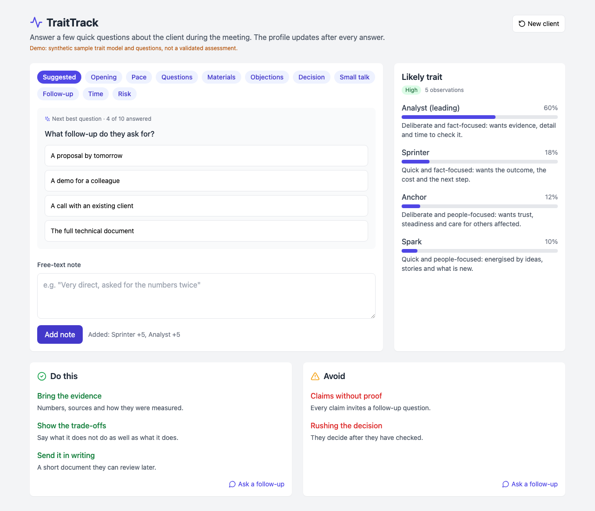
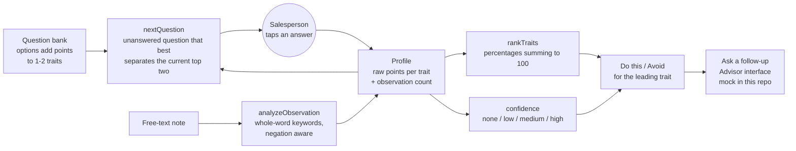
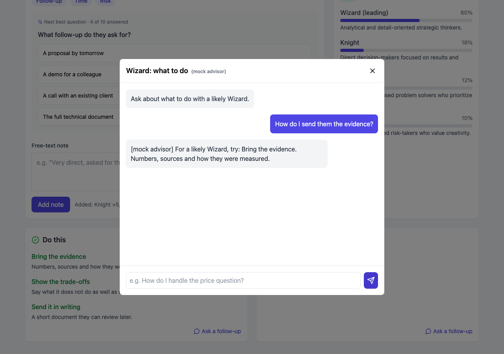

# traittrack

[](https://github.com/s0yabean/traittrack-demo/actions/workflows/ci.yml)

A demo I built during my Mindreader days, as CTO: a live, real-time test that helps a salesperson profile a client quickly when they have no information before the sale, like a cold Zoom meeting. Each answer or note updates a running estimate of the client's communication style, picks the next most useful question, and shows what to do and what to avoid.

The trait names follow Mindreader's public four-type model; the questions and guidance in this repo are illustrative samples written for the demo (see [Trait model](#trait-model)).



## The problem

A salesperson joins a cold Zoom meeting with a prospect they know nothing about: no referral, no notes, no posts or writing to analyse beforehand. Within the first few minutes they have to decide how to pitch: lead with numbers or with a story, push for a decision or give time. The only evidence is the meeting itself: how the client opens, what they ask, how they talk about risk. That evidence is lost if it has to be written up afterwards, and a long questionnaire can't be filled in while someone is talking to you.

So the input has to be fast (one tap per observation), the estimate has to update as the meeting goes, and the tool has to say how sure it is, so a close call between two styles doesn't get presented as a confident read.

## Approach



All of the logic is plain TypeScript in `src/lib/`, with no React in it, so it can be tested on its own:

- **Scoring (`scoring.ts`).** The profile keeps raw evidence points per trait, starting from a small prior so one answer can't swing a fresh profile to 100%. Percentages are computed from the points on display, with largest-remainder rounding so they always sum to 100. Because nothing is normalised in place, the order of answers doesn't change the result.
- **Confidence.** `none` until there is evidence; `low` whenever the top two traits are within 8 percentage points of each other; `high` only with a clear lead *and* at least five observations. The UI says "close call" and asks for another question rather than hiding the uncertainty.
- **Question selection (`selection.ts`).** With no evidence yet, the next question is the one whose options spread all traits furthest apart. After that, it is the unanswered question whose options best separate the current top two traits (mean absolute gap in points between them). Each tap goes where the profile is least sure. The salesperson can also browse by tag (Opening, Pace, Objections...) when the conversation turns to a topic.
- **Free-text notes (`observation.ts`).** Keyword matching on whole words, with a negation word right before a keyword ("not direct") cancelling it. Simple on purpose: it shows its work ("Added: Knight +5, Wizard +5"), and an LLM or trained classifier can replace it behind the same function signature.
- **Follow-up chat (`advisor.ts`).** An `Advisor` interface with one implementation, a mock that answers from the trait guidance. No network, no key.

## Trait model

Mindreader's method is HIS, Mindreader's Human Intelligence System. Its public four-type model, adapted from David Keirsey's temperament model, gives the trait names used here:

| Trait | In short |
|---|---|
| Knight | Direct decision-makers focused on results and efficiency |
| Explorer | Innovation-focused risk-takers who value creativity |
| Healer | Relationship-focused problem solvers who prioritize harmony |
| Wizard | Analytical and detail-oriented strategic thinkers |

The ten questions in `src/data/questions.ts` and the do/avoid guidance in `src/lib/traits.ts` are illustrative samples written for this demo, not Mindreader's question bank or training content, and they have not been validated. To use your own model, edit those two files; the scoring and selection code does not depend on the trait names.

## Results

This repo is a demo, not a measured deployment, so it has no results of its own. Mindreader's published numbers, including the independent test of its face model against third-party personality tests, are on the [Mindreader work page](https://tonytonggg.com/work/mindreader). The "never confident on a close call" rule here is the same principle described there.

## Quickstart

Needs Node 18 or later. No API keys, no database, no network calls.

```bash
npm install
npm run dev          # http://localhost:5173
```

Checks (the same commands CI runs):

```bash
npx tsc -b           # typecheck app, config files and tests
npm run lint
npm test             # vitest, 31 tests
npm run build
```



## Repo layout

```
src/
  lib/
    traits.ts         the four types (public names) + sample do/avoid guidance
    scoring.ts        profile, percentages, ranking, confidence
    selection.ts      next-question picker (separation of the top two traits)
    observation.ts    keyword scoring for free-text notes
    advisor.ts        Advisor interface + offline mock
  data/questions.ts   illustrative 10-question sample bank
  components/         QuestionPanel, ObservationInput, TraitScores, GuidancePanel, ChatModal
  App.tsx             state: one profile + answered question ids
test/                 vitest: scoring, selection, notes, mock advisor
docs/screenshots/     README images
.github/workflows/    CI: typecheck, lint, tests, build, gitleaks
```

## Design decisions and what I'd do next

- **What changed from the original demo.** The original stored percentages and re-normalised them after every answer, so rounding drifted and the result depended on answer order; it also sorted React state in place during render. The questions were fixed per tag, the free-text box matched substrings, and the chat reply was a hard-coded string. This version moves the logic into tested pure functions, stores raw points, adds the confidence rule and the adaptive next question, and puts the chat behind an interface.
- **Observations are not independent.** Two questions about pace both count fully, so a client who is simply in a hurry today scores as a Knight twice. A real version should weight questions by how much they overlap, or fit the weights from labelled meetings.
- **The points are hand-set.** Each option's points are a judgement call. With labelled data, they should be learned (for example a simple logistic model per trait), and the confidence thresholds should be calibrated against outcomes rather than picked.
- **One session, in memory.** No accounts, no saved clients, no CRM sync. "New client" resets everything.
- **What I'd do next:** combine this quiz with other evidence (notes, prior meetings) into the same running estimate, and log which suggested questions the salesperson skips, since a question nobody can answer mid-meeting is a bad question however well it separates traits on paper.

Read more about the product this fed into: [Mindreader, AI sales intelligence](https://tonytonggg.com/work/mindreader).

## Licence

MIT, copyright Tony Tong. See [LICENSE](LICENSE).
